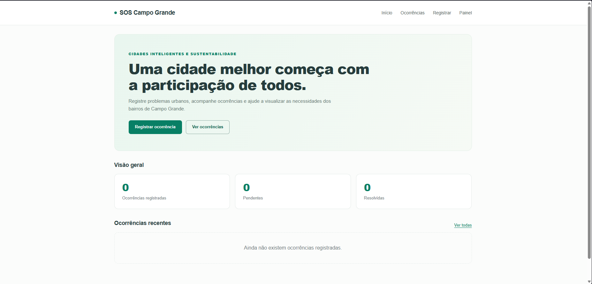

#  SOS Campo Grande

### Uma cidade melhor começa com a participação de todos.

O **SOS Campo Grande** é uma aplicação web desenvolvida em Python e Django, com o objetivo de facilitar o registro, a visualização e o acompanhamento de problemas urbanos na cidade de Campo Grande, Mato Grosso do Sul.

O projeto foi desenvolvido para um **Hackathon**, dentro do tema **Cidades Inteligentes e Sustentabilidade Local**, buscando demonstrar como a tecnologia pode incentivar a participação da população na melhoria dos espaços públicos.

---

##  Sobre o projeto

Problemas como buracos nas ruas, iluminação pública inadequada, descarte irregular de lixo e vazamentos de água afetam a qualidade de vida dos moradores.

O SOS Campo Grande propõe uma plataforma simples e acessível, onde os cidadãos podem registrar essas ocorrências e acompanhar seu status.

A aplicação também disponibiliza indicadores que ajudam a visualizar a quantidade de problemas cadastrados, pendentes e resolvidos.

> **Observação:** este é um protótipo acadêmico e não possui integração oficial com a Prefeitura de Campo Grande.

##  Funcionalidades

- **Registro de ocorrências:** cadastro de problemas urbanos com título, descrição, bairro e categoria.
- **Listagem de ocorrências:** visualização dos problemas registrados.
- **Filtros:** pesquisa de ocorrências por categoria e status.
- **Página inicial:** apresentação do projeto, indicadores gerais e registros recentes.
- **Painel de indicadores:** acompanhamento de ocorrências pendentes, em andamento e resolvidas.
- **Administração:** gerenciamento dos registros por meio do Django Admin.
- **Interface responsiva:** layout adaptado para computadores e dispositivos móveis.

##  Tecnologias utilizadas

| Tecnologia | Utilização |
|---|---|
| Python | Linguagem principal |
| Django | Framework web e backend |
| SQLite | Banco de dados |
| HTML5 | Estrutura das páginas |
| CSS3 | Estilização e responsividade |
| Git | Controle de versão |
| GitHub | Hospedagem do código-fonte |

##  Demonstração do sistema

###  Página inicial

Apresenta o objetivo do projeto, indicadores gerais e as ocorrências mais recentes.




##  Estrutura do projeto

```text
soscg/
├── app/                  # Configurações do Django
│   ├── settings.py
│   ├── urls.py
│   ├── asgi.py
│   └── wsgi.py
├── ocorrencias/          # Aplicação principal
│   ├── migrations/
│   ├── static/
│   │   └── ocorrencias/
│   │       └── style.css
│   ├── templates/
│   │   └── ocorrencias/
│   │       ├── base.html
│   │       ├── home.html
│   │       ├── lista.html
│   │       ├── cadastrar.html
│   │       └── painel.html
│   ├── admin.py
│   ├── forms.py
│   ├── models.py
│   ├── urls.py
│   ├── views.py
│   └── tests.py
├── docs/
│   └── images/           # Capturas de tela
├── manage.py
├── requirements.txt
├── .gitignore
└── README.md
```

##  Como executar o projeto

### Pré-requisitos

- Python instalado
- Git instalado
- Editor de código, como VS Code

### 1. Clonar o repositório

```bash
git clone https://github.com/SEU-USUARIO/SEU-REPOSITORIO.git
cd SEU-REPOSITORIO
```

Substitua `SEU-USUARIO` e `SEU-REPOSITORIO` pelos dados reais do GitHub.

### 2. Criar o ambiente virtual

No Windows:

```powershell
python -m venv .venv
```

### 3. Ativar o ambiente virtual

No PowerShell:

```powershell
.\.venv\Scripts\Activate.ps1
```

### 4. Instalar as dependências

```powershell
python -m pip install -r requirements.txt
```

### 5. Aplicar as migrações

```powershell
python manage.py migrate
```

### 6. Iniciar o servidor

```powershell
python manage.py runserver
```

Acesse:

**http://127.0.0.1:8000/**

### 7. Criar um administrador (opcional)

```powershell
python manage.py createsuperuser
```

Depois, acesse:

**http://127.0.0.1:8000/admin/**

##  Testes

Para verificar a configuração do projeto:

```powershell
python manage.py check
```

Para executar os testes automatizados:

```powershell
python manage.py test
```

##  Banco de dados

O projeto utiliza SQLite para armazenar as ocorrências.

O modelo principal é `Ocorrencia`, contendo informações como:

- Título e descrição
- Bairro
- Categoria do problema
- Status da ocorrência
- Data de criação

Os dados são manipulados por meio do ORM do Django.

##  Melhorias futuras

- [ ] Autenticação de moradores
- [ ] Upload de fotografias das ocorrências
- [ ] Geolocalização dos problemas em um mapa
- [ ] Busca por bairro
- [ ] Gráficos interativos
- [ ] Sistema de notificações
- [ ] Moderação e validação de ocorrências
- [ ] Integração com serviços públicos

## Objetivo do Hackathon

Demonstrar como uma solução digital pode aproximar a população dos problemas urbanos e contribuir para decisões baseadas em informações organizadas.

O SOS Campo Grande busca incentivar a cidadania, a transparência e a participação comunitária.

##  Desenvolvimento

Projeto desenvolvido para fins acadêmicos e de apresentação em Hackathon.

**Grupo:** [Bar sem Lona]

**Desenvolvedor(es):** [Pedro Kawahata | Antônio Raquita | Kaemy Reis]

**Instituição:** [Unigran]

**Evento:** [Hackathon UniGran]

**Local:** Campo Grande — MS

---

**SOS Campo Grande — Tecnologia e participação por uma cidade melhor.**
